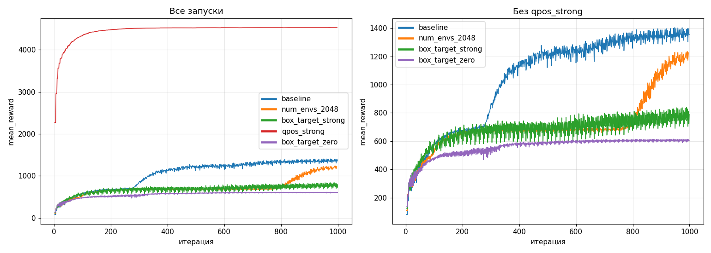

# Практика 2: эксперименты с обучением PandaPickCube

Кодинцев Алексей, ВГУ

Задача — робот Franka Panda должен взять кубик и перенести его к цели. Обучал PPO (RSL-RL) в MuJoCo Playground. Обучение шло в Google Colab, а проверку обученных моделей делал у себя в Docker

## Параметры обучения

Прежде чем что-то менять, нашёл где лежат основные параметры:

| Параметр | Группа | Что делает | Где задаётся | По умолчанию |
|---|---|---|---|---|
| num_envs | параметр среды | сколько копий среды работает параллельно | `NUM_ENVS` в ноутбуке, `--num_envs` у train.py | 4096 |
| learning_rate | гиперпараметр алгоритма | шаг обновления весов в PPO | `cfg_dict["algorithm"]["learning_rate"]`, приходит из конфига playground | 0.001 |
| max_iters | гиперпараметр алгоритма | сколько итераций длится обучение | `MAX_ITERS` в ноутбуке, `--max_iters` у train.py | 1001 |
| gripper_box | параметр задачи (награда) | вес награды за приближение гриппера к кубику | `env_cfg.reward_config.scales.gripper_box` до `registry.load` | 4.0 |

## Как сравнивал

За основу взял стандартные настройки: 4096 параллельных сред, 1001 итерация, seed 1, `playground[learning]==0.2.0`. В каждом следующем запуске менял только один параметр чтобы было понятно что именно повлияло

Смотрел на две цифры:

- **mean_reward** — средняя награда на последней итерации обучения. Именно её старается увеличить алгоритм
- **SR** — в скольких эпизодах из 10 кубик в конце оказался ближе 5 см к цели. Проверял на последнем чекпоинте `model_1000.pt`

Команды запуска нет, потому что учил в Colab. Что менял в ноутбуке написано в столбце «Изменения»

## Результаты

| Эксперимент | Изменения | Команда запуска | mean_reward | SR | Δ mean_reward | Δ SR | Как вёл себя робот |
|---|---|---|---:|---:|---:|---:|---|
| baseline | — | | 1355.67 | 9/10 | — | — | Брал кубик каждый раз, к цели донёс в 9 из 10. В одном эпизоде не хватило полсантиметра. Учился ~32 мин |
| num_envs_2048 | `NUM_ENVS = 2048` | | 1226.27 | 9/10 | −129.40 | 0 | Почти то же самое, тоже 9 из 10. Обучение заняло всего 18 мин |
| box_target_strong | `env_cfg.reward_config.scales.box_target = 40.0` | | 788.52 | 0/10 | −567.15 | −9 | Тянется в сторону кубика но ни разу его не взял. 29 мин |
| qpos_strong | `env_cfg.reward_config.scales.robot_target_qpos = 30.0` | | 4528.53 | 0/10 | +3172.86 | −9 | Просто стоит в исходной позе и не двигается. 25 мин |
| box_target_zero | `env_cfg.reward_config.scales.box_target = 0.0` | | 603.20 | 0/10 | −752.47 | −9 | Подъезжает к кубику и замирает рядом не поднимая. 33 мин |

Строки с весами награды я вставлял сразу после `registry.get_default_config(ENV_NAME)`, до `registry.load`

## Кривые обучения

Справа тот же график без `qpos_strong`, а то из-за него остальные линии сливаются внизу

У baseline примерно на 280-й итерации награда резко прыгает вверх — это момент когда робот научился брать кубик и за доставку начали платить. У `num_envs_2048` такой же скачок есть, но только около 800-й итерации, и к концу кривая всё ещё растёт. У `box_target_strong` и `box_target_zero` скачка нет совсем. `qpos_strong` выходит на плато почти сразу

Графики по каждому запуску отдельно лежат в `curves/`

## Файлы

Видео всех пяти прогонов лежат отдельно, в папке `videos/`: `baseline.mp4`, `num_envs_2048.mp4`, `box_target_strong.mp4`, `qpos_strong.mp4`, `box_target_zero.mp4`. В каждом по три эпизода

- `train.ipynb` — ноутбук для Colab в варианте baseline. Для остальных запусков менял в нём то что написано в таблице
- `curves/` — графики mean_reward
- `experiments/<имя>/` — по папке на каждый запуск:
  - `config.json` — конфиг обучения
  - `model_1000.pt` — финальная модель, на ней считал SR
  - `events.out.tfevents.*` — логи TensorBoard, кривые можно посмотреть командой `tensorboard --logdir experiments`
  - `inference.txt` — вывод проверки на 10 эпизодах
  - `video.mp4` — то же видео, что в `videos/`

Промежуточные чекпоинты (каждые 50 итераций) не выкладывал, их там по 21 штуке на запуск

## Что получилось

**Меньше сред.** Когда сред стало вдвое меньше обучение пошло почти в два раза быстрее, а награда чуть просела. На самой задаче это никак не сказалось — робот по-прежнему справлялся в 9 случаях из 10. Но по графику видно что научился он гораздо позже чем baseline и на плато так и не вышел, так что с меньшим числом сред на всякий случай лучше давать больше итераций

**Сильнее награда за доставку.** Я ожидал что если увеличить `box_target` в пять раз, робот станет лучше носить кубик. Вышло наоборот: он вообще перестал его брать. Похоже дело в том, что эта награда начисляется только после того как гриппер коснулся кубика. Робот до касания так и не дошёл, поэтому большой бонус ни разу не сработал и обучение застряло на награде около 700–800. На графике это хорошо видно: скачка как у baseline нет, линия так и идёт ровно до конца

**Сильнее награда за исходную позу.** Это самый показательный случай. Награда получилась в три с лишним раза выше, чем у baseline, а задача не решена ни разу. Робот понял что выгоднее всего просто стоять на месте, и именно это и делал. По одной награде тут легко ошибиться и решить, что модель стала лучше

## Свой эксперимент: убрать награду за доставку

Гипотезу записал до запуска:

- **Параметр:** `box_target` в `env_cfg.reward_config.scales`, по умолчанию 8.0. Это награда за то, что кубик близко к цели
- **Изменение:** ставлю 0, остальное как в baseline
- **Что будет с наградой:** упадёт, потому что за доставку больше ничего не платят
- **Что будет с SR:** тоже упадёт, скорее всего до нуля. Подойти к кубику робота всё ещё поощряет `gripper_box`, а нести его к цели смысла уже нет
- **Почему так думаю:** убираю главную часть задачи, поэтому обе цифры должны пойти вниз вместе. Это не как в `qpos_strong`, где награда выросла а задача развалилась

**Что вышло:** награда 603.20, SR 0 из 10, обучение 33 минуты. Кубик робот не поднял ни разу

Гипотеза подтвердилась и по награде и по SR, обе цифры упали вместе. Одно уточнение: я думал робот хотя бы будет хватать кубик. На деле он только подъезжает к нему — показатель приближения к кубику около 0.96 — и останавливается

## Вывод

Если смотреть только на награду, сильнее всего всё поменял `qpos_strong`: +3173. Но для самой задачи он оказался худшим вариантом. Если смотреть на SR, все три изменения награды одинаково всё сломали, а количество сред на результат почти не повлияло. Получается что награда показывает, насколько хорошо алгоритм набирает очки по заданной формуле, а SR — справляется ли робот с тем, что нам на самом деле нужно. Для этой задачи главным считаю SR
